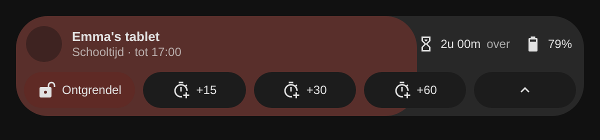
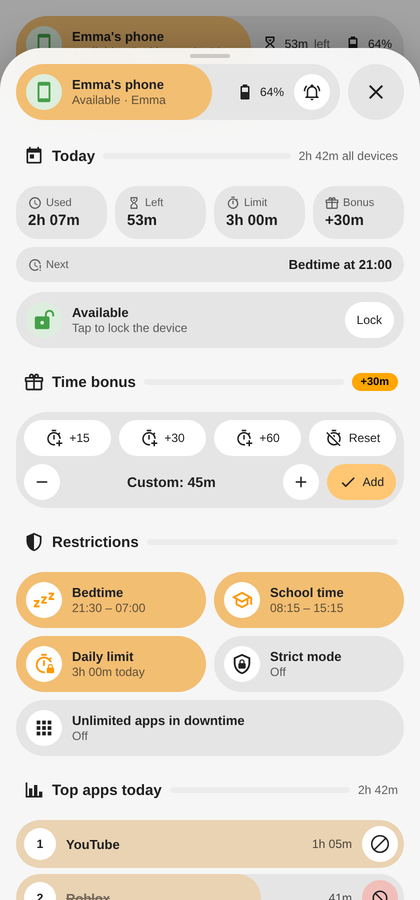
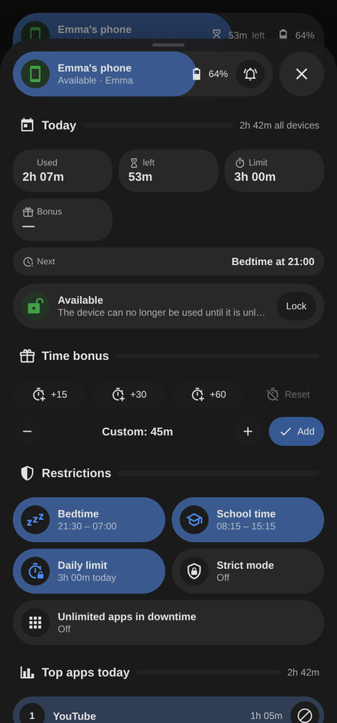
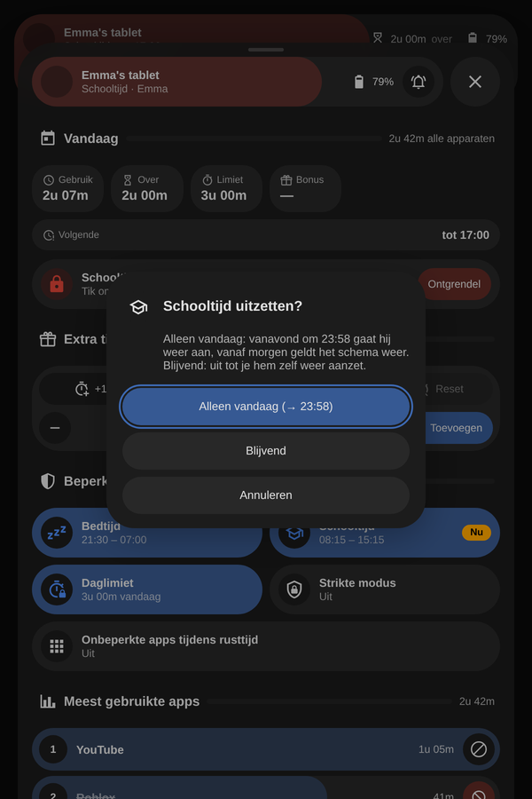

# Family Link Bubble Card

[](https://hacs.xyz)
[](https://github.com/rick00001/ha-family-link-bubble-card/actions/workflows/validate.yml)
[](https://github.com/rick00001/ha-family-link-bubble-card/releases)

A dashboard card for the [HAFamilyLink](https://github.com/noiwid/HAFamilyLink) integration (Google Family Link in Home Assistant), styled like [Bubble Card](https://github.com/Clooos/Bubble-Card).

- **Compact card:** lock and unlock, +15, +30 and +60 minutes, time left and battery. A tap opens a pop-up with all the details.
- **Or everything in one card** (`mode: full`).
- Needs nothing besides HAFamilyLink. If you use Bubble Card, its theme variables are picked up, so the card matches your other Bubble Cards.
- English and Dutch.

<p>
  <br>
  
  
  
</p>

## Installation

### HACS (recommended)

[](https://my.home-assistant.io/redirect/hacs_repository/?owner=rick00001&repository=ha-family-link-bubble-card&category=plugin)

Or by hand:
1. Open **HACS → ⋮ → Custom repositories**.
2. Add `https://github.com/rick00001/ha-family-link-bubble-card` with type **Dashboard**.
3. Search for **Family Link Bubble Card** and download it.
4. Reload the browser. HACS adds the dashboard resource itself.

### Manual
1. Copy `dist/ha-family-link-bubble-card.js` to `/config/www/`.
2. Go to **Settings → Dashboards → ⋮ → Resources → Add resource**. URL: `/local/ha-family-link-bubble-card.js?v=1.1.0`, type: **JavaScript module**.
3. Reload the browser. Raise `?v=` every time you update the file.

## Usage

```yaml
type: custom:familylink-bubble-card
entity: switch.emmas_phone   # the phone or tablet switch
mode: popup                  # popup (default) | full
```

You can also use the visual editor: **Add card → Family Link Bubble Card**.

The card only needs the device switch. It finds every other entity of the child and the device through the integration, so entity ids that start with an area name work too.

| Option | Default | Description |
|---|---|---|
| `entity` | required | Device switch, `switch.<device>` |
| `mode` | `popup` | `popup`: compact card plus details pop-up. `full`: everything in one card |
| `name` / `icon` | device name / live icon | |
| `sections` | all | Any of `today, bonus, restrictions, apps, week, schedule, settings`, in your order |
| `top_apps` | `5` | 0–10 |
| `max_daily_limit` | `360` | Range of the weekly limit sliders, in minutes |
| `hash` | `#fl-<device>` | Lets another card open the pop-up (`tap_action: navigate`, `navigation_path: '#fl-emmas_phone'`) |
| `language` | HA language | `en` or `nl` |
| `school_today_until` | `23:58` | When school time that was switched off "only today" goes back on |

## What's in it

- **Compact card:**
  - A fill showing used ÷ (limit + bonus), and a green or red icon.
  - The status (Available, Locked, Bedtime, School time, Limit reached or Bonus active), with the next restriction in 24-hour time ("School time · until 17:00").
  - Time left and battery.
  - **Lock/Unlock** (asks to confirm), **+15 +30 +60**, and **▲** for the details.
- **Pop-up / full card:**
  - **Today:** used, left, limit, bonus, next restriction, and a lock tile.
  - **Time bonus:** +15, +30, +60, Reset, and a custom amount.
  - **Restrictions:** bedtime, school time, daily limit, strict mode and unlimited apps in downtime, each with today's times and a *Now*/*Reached* badge.
  - **Top apps:** usage bars, and a block/unblock button per app (asks to confirm).
  - **Weekly limits:** sliders. Drag sideways; scrolling up and down is not caught.
  - **Schedule:** bedtime and school time, edited with a 24-hour picker.
  - **Settings:** web filter, calls & texts, Play approvals and rating, plus app and site counts. Tap a count to see the list.
- **School time off "only today":** switching school time off asks *Only today / Permanently / Cancel*. The integration's switch also turns school time off in the weekly schedule, so on its own it stays off for the following days too.
  - *Only today* also creates an automation, *Family Link: schooltijd weer aan – <child> (date)*. It switches school time back on at 23:58 that same day, so the weekly schedule applies again from tomorrow.
  - Choosing it again later reuses the same automation, and you can delete it any time.
  - Only Home Assistant administrators can create automations; other users get a message instead.
- **Closing the pop-up:** ✕, swipe the header down, tap outside it, press Esc, or use the browser back button.

## Requirements
- Home Assistant 2024.10 or newer
- [HAFamilyLink](https://github.com/noiwid/HAFamilyLink)

## Releasing (for the maintainer)
1. Raise `FLB_VERSION` in `dist/ha-family-link-bubble-card.js`.
2. Commit, then `git tag v1.2.0 && git push --tags`.
3. The *Release* workflow publishes the GitHub release, and HACS offers the update.

## License
MIT
